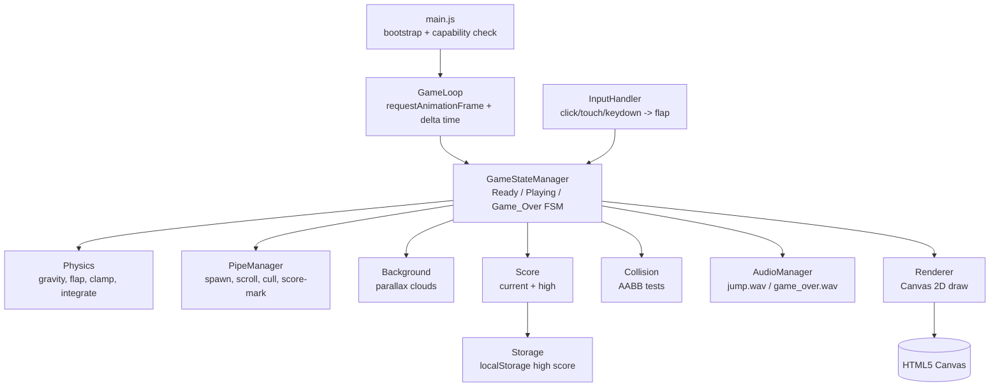
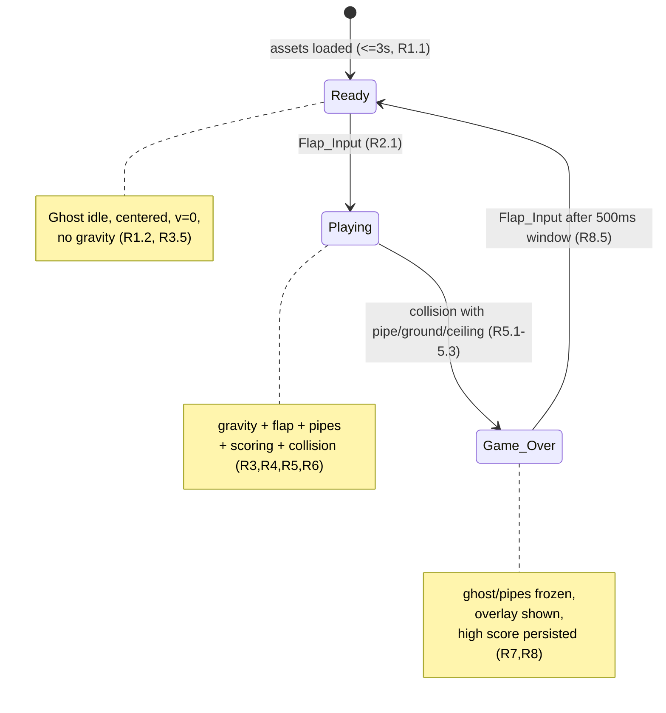

# Design Document

## Overview

Flappy Kiro is a single-page, dependency-light browser game implemented with the HTML5 Canvas 2D API and vanilla JavaScript. The entire game ships as a static bundle (one `index.html` plus a small set of ES modules and the existing `assets/`) that runs by opening the HTML file directly or serving the folder with any trivial static server. There is no build step, framework, or runtime dependency.

The game renders a light blue hand-drawn scene: a white ghost (`assets/ghosty.png`) that falls under gravity and rises on each flap, green pipes scrolling right-to-left with randomized passable gaps, semi-transparent parallax clouds, a dark gray ground strip, and a bottom score readout formatted `Score: {current} | High: {high}`. A finite state machine drives three states — Ready, Playing, Game_Over — and a single `requestAnimationFrame` loop with delta-time-scaled motion keeps movement frame-rate independent at a 60 FPS target.

### Design Goals and Rationale

- **Plain Canvas + vanilla JS (no framework).** A single-screen arcade game with imperative per-frame rendering maps naturally onto an immediate-mode Canvas loop. Introducing React/a bundler would add weight and a build step without benefit. This keeps the game runnable from a single HTML file, satisfying the no-plugin constraint (Requirement 10.1).
- **ES modules for separation of concerns.** The logic splits into small modules (state manager, physics, pipe manager, background, renderer, input, audio, storage, score). Native ES modules give clean boundaries with zero tooling. The pure-logic modules (physics, pipe generation, scoring, storage parsing) are written as side-effect-free functions so they can be unit- and property-tested in isolation (see Testing Strategy).
- **Delta-time simulation.** All motion is expressed in units-per-second and multiplied by the measured frame delta, so a 55 FPS machine and a 60 FPS machine see the same on-screen travel per second (Requirement 10.2, 10.4). Requirement acceptance values stated per-frame (e.g., gravity "pixels per frame per frame") are converted to per-second constants assuming the 60 FPS reference, so the per-frame behavior at 60 FPS matches the requirement while remaining frame-rate independent.
- **Fixed logical resolution.** The Play_Area uses a fixed internal coordinate space (e.g., 480×640 logical pixels) that the canvas renders into, keeping physics constants, pipe margins, and gap sizing deterministic regardless of the display size.

### Per-Frame to Per-Second Constant Conversion

Requirements express several constants per animation frame at the implied 60 FPS target. The engine stores them per second (`×60`) and scales by delta time each frame. Chosen reference values:

| Quantity | Requirement range | Per-frame @60 | Per-second constant |
|---|---|---|---|
| Gravity acceleration | 0.3–0.6 px/frame² (R3.1) | 0.45 px/frame² | `GRAVITY = 0.45 × 60 × 60 = 1620` px/s² |
| Max downward velocity | 8–15 px/frame (R3.3) | 11 px/frame | `MAX_FALL = 11 × 60 = 660` px/s |
| Flap impulse | fixed upward (R2.3) | −8 px/frame | `FLAP_IMPULSE = −8 × 60 = −480` px/s |
| Pipe scroll speed | 120–200 px/s (R4.1) | — | `PIPE_SPEED = 160` px/s |
| Pipe spacing | 200–350 px (R4.2) | — | `PIPE_SPACING = 260` px (center-to-center) |
| Gap vertical margin | ≥50 px from edges (R4.4) | — | `GAP_MARGIN = 60` px |
| Gap height | ≥2× ghost height (R4.5) | — | `GAP_HEIGHT = 2.5 × ghostHeight` |
| Cloud speeds | < pipe speed, ≥2 distinct (R9.5, R9.6) | — | `CLOUD_SPEEDS = [20, 45]` px/s |

(Upward is negative Y per standard canvas convention.) These are the single source of truth in a `config.js` constants module; all requirement-bounded values sit strictly inside their ranges to leave headroom.

## Architecture

The game is organized as a set of cooperating modules coordinated by a central game loop. Pure logic (physics, pipe generation, collision math, scoring, storage parsing) is isolated from side-effecting concerns (canvas rendering, DOM input, audio playback, `localStorage` I/O) so the logic can be tested deterministically.



### Game Loop

A single `requestAnimationFrame`-driven loop is the heartbeat. Each tick:

1. Compute `deltaSeconds = (now - lastTimestamp) / 1000`, clamped to a maximum (e.g., 0.05 s ≈ 20 FPS floor) to prevent a huge physics jump after a background-tab pause or a long stall.
2. Drain at most one queued Flap_Input for this frame (Requirement 2.5) and hand it to the state manager.
3. `update(deltaSeconds)` — advance physics, pipes, clouds, scoring, and collision for the active state.
4. `render()` — draw the current scene.
5. Store `now` as `lastTimestamp` and request the next frame.

Because every positional update multiplies a per-second rate by `deltaSeconds`, on-screen travel per wall-clock second is constant across frame rates (Requirement 10.4). Clouds update in every state (Requirement 9.4); gravity, pipe scrolling, and scoring update only in Playing (Requirements 3, 4, 8.2).

```mermaid
sequenceDiagram
    participant RAF as requestAnimationFrame
    participant Loop as GameLoop
    participant Input as InputHandler
    participant SM as GameStateManager
    participant R as Renderer
    RAF->>Loop: tick(now)
    Loop->>Loop: deltaSeconds = clamp((now - last)/1000)
    Loop->>Input: consumeOneFlap()
    Input-->>SM: flap? (at most one)
    Loop->>SM: update(deltaSeconds)
    Loop->>R: render(state)
    Loop->>RAF: requestAnimationFrame(tick)
```

### State Machine



- **Ready → Playing** (R2.1): first Flap_Input; on entry Score resets to 0 (R6.1) and ghost velocity is set to the flap impulse (R3.4).
- **Playing → Game_Over** (R5.1–5.3): any AABB collision; on entry high score is evaluated/persisted (R7.1–7.5), game-over sound plays once (R8.1), ghost and pipes freeze (R8.2), and a 500 ms input-ignore window starts (R8.4).
- **Game_Over → Ready** (R8.5): a Flap_Input after the ignore window resets score, ghost position, and clears pipes.

Note: Game_Over returns to Ready (not directly to Playing); the next session begins when the Ready-state Flap_Input fires. The flap that leaves Game_Over is consumed by the reset transition and does not itself start play.

### Capability Check and Bootstrap

On load, `main.js` verifies that a canvas with a 2D context and `requestAnimationFrame` are available (Requirement 10.5). If not, it reveals a static "unsupported browser" message element and never constructs the loop, so the game cannot enter Playing. Otherwise it kicks off asynchronous asset loading (ghost image + two audio clips) with a watchdog so the Ready_State is reached within 3 seconds even if an asset is slow or fails (Requirements 1.1, 9.11).

## Components and Interfaces

Each component is a small ES module. Signatures below are illustrative (JSDoc-style) contracts, not final code.

### config.js — Constants
Exports the frozen constant table above (dimensions, physics, pipe, cloud, timing values) as the single source of truth.

### GameStateManager — FSM + orchestration
```
createGame(deps) -> {
  state: 'ready' | 'playing' | 'gameOver',
  update(deltaSeconds),      // advances the active state
  handleFlap(),              // routes a flap by current state
  getSnapshot()              // immutable view for the renderer
}
```
Owns the authoritative world: `ghost`, `pipes[]`, `clouds[]`, `score`, `highScore`, and `gameOverEnteredAt`. Delegates math to the pure modules and effects to Audio/Storage/Renderer.

### Physics — pure
```
applyGravity(ghost, deltaSeconds) -> ghost'      // v += GRAVITY*dt, clamp to MAX_FALL (R3.1,R3.3)
applyFlap(ghost) -> ghost'                        // v = FLAP_IMPULSE (R2.3)
integrate(ghost, deltaSeconds) -> ghost'          // y += v*dt (R3.2)
```
All return new ghost state; no mutation, no globals. Enables deterministic property tests.

### PipeManager — pure core + thin stateful wrapper
```
spawnPipe(rng, playArea, lastPipeX) -> Pipe       // random gapY within margins (R4.4), fixed gapHeight (R4.5)
advancePipes(pipes, deltaSeconds) -> pipes'       // x -= PIPE_SPEED*dt (R4.1)
cullOffscreen(pipes, playArea) -> pipes'          // drop pipes fully past left edge (R4.6)
needsSpawn(pipes, playArea) -> boolean            // spacing interval reached (R4.2)
```
`rng` is an injectable `() => [0,1)` so tests can seed randomness. The gap vertical center is chosen uniformly in `[GAP_MARGIN + GAP_HEIGHT/2, playArea.height - groundHeight - GAP_MARGIN - GAP_HEIGHT/2]`.

### Collision — pure
```
aabbIntersect(a, b) -> boolean                    // standard AABB overlap
ghostHitsPipe(ghost, pipe) -> boolean             // test ghost box vs top & bottom segment boxes (R5.1)
ghostHitsBounds(ghost, playArea) -> boolean       // ceiling/ground (R5.2,R5.3)
```

### Score — pure + storage glue
```
scorePasses(ghost, pipes) -> { pipes', gained }   // mark unscored pipes whose right edge is left of ghost.x; count once (R6.2,R6.5)
nextHighScore(score, highScore) -> highScore'     // max(score, highScore) (R7.1,R7.2)
```

### Background — parallax clouds (pure update)
```
advanceClouds(clouds, deltaSeconds, playArea) -> clouds'  // x -= speed*dt; wrap past left edge to right (R9.4,R9.7)
```
Clouds carry per-cloud `speed` drawn from `CLOUD_SPEEDS` so at least two differ and all are `< PIPE_SPEED` (R9.5, R9.6).

### InputHandler — side-effecting (DOM)
Registers `mousedown`/`click`, `touchstart`, and `keydown` (Space) listeners; normalizes all three to a single `flap` signal and enqueues at most one per frame for the loop to consume (R2.4, R2.5). Calls `preventDefault` on Space to avoid page scroll.

### AudioManager — side-effecting
```
playFlap()      // assets/jump.wav, once per flap (R2.2)
playGameOver()  // assets/game_over.wav, once per game over (R8.1)
```
Preloads clips; uses cloned audio nodes (or resets `currentTime`) so rapid flaps each produce one sound. Degrades silently if audio is blocked.

### Storage — side-effecting with pure parse
```
readHighScore() -> number       // parse localStorage; non-negative integer else 0 (R1.6-1.8)
writeHighScore(value)           // best-effort write, swallow errors (R7.3,R7.4)
parseHighScore(raw) -> number   // PURE: raw string|null -> valid int or 0 (R1.7)
```
`parseHighScore` is pure and separately testable; `read/writeHighScore` wrap it with `try/catch` around `localStorage`.

### Renderer — side-effecting (Canvas 2D)
Draws, in order: light blue background fill, clouds (at configured opacity), pipes (green), ground (dark gray), ghost (image or placeholder), score text, and the game-over overlay when applicable. Reads an immutable snapshot; performs no mutation (R9.1–9.11).

## Data Models

All world data is plain JS objects in the fixed logical coordinate space (origin top-left, Y increases downward, upward velocity negative).

### Ghost
```
{
  x: number,          // fixed, horizontally centered (R1.2)
  y: number,          // vertical position, driven by physics
  vy: number,         // vertical velocity, px/s (negative = up)
  width: number,      // rendered width (fits Play_Area, R9.1)
  height: number      // rendered height; gap height >= 2*height (R4.5)
}
```
Bounding box for AABB: `{ left: x - width/2, top: y - height/2, right: x + width/2, bottom: y + height/2 }` (or top-left origin — one convention used consistently).

### Pipe
```
{
  x: number,          // center-line X, scrolls right->left (R4.1)
  gapY: number,       // vertical center of the gap (R4.4)
  gapHeight: number,  // fixed, >= 2*ghost.height (R4.5)
  width: number,      // pipe body width
  scored: boolean     // true once counted (R6.2,R6.5)
}
```
Derived segment boxes:
- Top segment: from Ceiling (y=0) down to `gapY - gapHeight/2`.
- Bottom segment: from `gapY + gapHeight/2` down to the top of the Ground.

### Cloud
```
{
  x: number,
  y: number,          // within background region above Ground (R9.2)
  width: number,
  height: number,
  speed: number,      // from CLOUD_SPEEDS; < PIPE_SPEED (R9.5,R9.6)
  opacity: number     // 0.3-0.7 (R9.3)
}
```

### GameState (world snapshot)
```
{
  phase: 'ready' | 'playing' | 'gameOver',   // Game_State (R: FSM)
  ghost: Ghost,
  pipes: Pipe[],
  clouds: Cloud[],
  score: number,                              // current (R6)
  highScore: number,                          // persisted best (R7)
  gameOverEnteredAt: number | null,           // timestamp for 500ms window (R8.4)
  playArea: { width, height, groundHeight },
  assets: { ghostImage: Image | null, flap: Audio, gameOver: Audio },
  unsupported: boolean                        // capability check (R10.5)
}
```

### Play_Area / coordinate conventions
Fixed logical size (e.g., 480×640). The Ground occupies the bottom `groundHeight` strip (R9.9); the playable vertical range for the ghost and gaps is `[0, height - groundHeight]`. The score display sits at the bottom (R6.3, R9.10).

## Correctness Properties

*A property is a characteristic or behavior that should hold true across all valid executions of a system — essentially, a formal statement about what the system should do. Properties serve as the bridge between human-readable specifications and machine-verifiable correctness guarantees.*

The following properties were derived from the acceptance criteria via the prework analysis. After reflection, logically redundant criteria were consolidated: the gravity-increase and max-velocity-clamp criteria combine into one integration-with-clamp property; the three collision criteria (pipe, ground, ceiling) combine into one AABB-collision property; the high-score branches and non-negativity criteria combine into one monotonicity property; the per-pipe scoring and "exactly once" criteria combine into one scoring property; and the two cloud-speed criteria combine into one parallax property. Criteria classified as EXAMPLE, EDGE_CASE, INTEGRATION, or SMOKE in the prework are covered by example/integration tests in the Testing Strategy rather than by properties here.

### Property 1: High score parsing yields a valid non-negative integer

*For any* raw value read from Local_Storage (including `null`, non-numeric strings, floats, negatives, and oversized values), `parseHighScore(raw)` returns a non-negative integer; and *for any* non-negative integer `n`, `parseHighScore(String(n)) === n`.

**Validates: Requirements 1.5, 1.6, 1.7**

### Property 2: Flap sets a fixed upward impulse regardless of prior velocity

*For any* Ghost with any vertical velocity `vy`, `applyFlap(ghost).vy === FLAP_IMPULSE`, discarding any accumulated downward velocity; and the Ready→Playing transition sets the Ghost's velocity to the same `FLAP_IMPULSE`.

**Validates: Requirements 2.3, 3.4**

### Property 3: Flap input source equivalence

*For any* flap event originating from a mouse click, a touch tap, or a Spacebar press, the normalized flap signal and the resulting Game state change are identical.

**Validates: Requirements 2.4**

### Property 4: At most one flap processed per frame

*For any* count `N ≥ 1` of Flap_Input events queued within a single animation frame, consuming input for that frame applies exactly one flap impulse and discards the remaining `N − 1`.

**Validates: Requirements 2.5**

### Property 5: Gravity integrates velocity and clamps to maximum fall speed

*For any* Ghost and any delta time `dt ≥ 0` in the Playing_State, `applyGravity` increases downward velocity by `GRAVITY × dt` and the resulting velocity never exceeds `MAX_FALL`; across any sequence of frames, `vy ≤ MAX_FALL` always holds.

**Validates: Requirements 3.1, 3.3**

### Property 6: Position integrates from velocity

*For any* Ghost and any delta time `dt ≥ 0`, `integrate(ghost, dt).y === ghost.y + ghost.vy × dt`.

**Validates: Requirements 3.2**

### Property 7: Ready state holds the Ghost still

*For any* sequence of delta times while in the Ready_State, the Ghost's vertical position and velocity remain at their fixed starting values (`vy === 0`, no gravity applied).

**Validates: Requirements 3.5**

### Property 8: Pipes scroll left at a fixed speed

*For any* set of Pipes and any delta time `dt ≥ 0` in the Playing_State, `advancePipes` sets each Pipe's `x` to `x − PIPE_SPEED × dt`.

**Validates: Requirements 4.1**

### Property 9: Pipe spawn spacing is constant

*For any* sequence of generated Pipes, the center-to-center horizontal distance between each consecutively generated pair equals `PIPE_SPACING`.

**Validates: Requirements 4.2**

### Property 10: Generated gaps lie within the Play_Area with required margins

*For any* random value in `[0, 1)` supplied to `spawnPipe`, the resulting Gap's top edge is at least `GAP_MARGIN` (≥ 50 px) below the Ceiling and its bottom edge is at least `GAP_MARGIN` above the Ground, and the Gap height equals the fixed value `≥ 2 × ghost.height`.

**Validates: Requirements 4.4, 4.5**

### Property 11: Offscreen pipes are culled, visible pipes retained

*For any* set of Pipes, `cullOffscreen` removes exactly those whose right edge is past the left edge of the Play_Area and retains every other Pipe unchanged.

**Validates: Requirements 4.6**

### Property 12: Collision with any pipe, the Ground, or the Ceiling ends the game

*For any* Ghost and world geometry in the Playing_State, the Game transitions to Game_Over_State if and only if the Ghost's bounding box intersects a Pipe segment's bounding box (via AABB overlap), or the Ghost's bottom edge reaches/passes the Ground top, or the Ghost's top edge reaches/passes the Ceiling.

**Validates: Requirements 5.1, 5.2, 5.3**

### Property 13: No collision transitions outside the Playing_State

*For any* world geometry while the Game is in the Ready_State or Game_Over_State, evaluating collisions produces no state transition.

**Validates: Requirements 5.4**

### Property 14: Each pipe scores exactly once per session

*For any* sequence of frames in the Playing_State, each Pipe contributes at most 1 to the Score: `scorePasses` increments the Score by 1 and marks a Pipe as scored the first frame the Ghost's horizontal position passes that Pipe's right edge, and re-running `scorePasses` never re-counts an already-scored Pipe. The Score is always a non-negative integer.

**Validates: Requirements 6.2, 6.4, 6.5**

### Property 15: High score is the running maximum and never decreases

*For any* current Score `s` and stored High_Score `h` (both non-negative integers), `nextHighScore(s, h) === max(s, h)`; the High_Score never decreases across Game_Over transitions and is always a non-negative integer.

**Validates: Requirements 7.1, 7.2, 7.6**

### Property 16: Game_Over freezes the Ghost and Pipes

*For any* sequence of delta times while in the Game_Over_State, the Ghost's vertical position and velocity and every Pipe's horizontal position remain unchanged (no gravity, no scrolling).

**Validates: Requirements 8.2**

### Property 17: Game_Over input-ignore window gates restart

*For any* elapsed time since entering the Game_Over_State, a Flap_Input received within the first 500 ms produces no state transition, and a Flap_Input received at or after 500 ms triggers the restart transition.

**Validates: Requirements 8.4**

### Property 18: Restart resets the world and returns to Ready

*For any* Game_Over_State with any Score, Ghost position, and set of Pipes, a Flap_Input after the ignore window resets the Score to 0, resets the Ghost to its starting position, removes all active Pipes, and sets the phase to Ready.

**Validates: Requirements 8.5**

### Property 19: Cloud opacity stays within the configured range

*For any* Cloud, its opacity is between 0.3 and 0.7 inclusive.

**Validates: Requirements 9.3**

### Property 20: Clouds advance and wrap in every state

*For any* Game_State and any delta time `dt > 0`, `advanceClouds` decreases each Cloud's `x` by `speed × dt`; and *for any* Cloud whose right edge has moved past the left edge of the Play_Area, it is repositioned so its `x` is at or beyond the right edge of the Play_Area.

**Validates: Requirements 9.4, 9.7**

### Property 21: Cloud speeds are distinct and slower than pipes

*For any* generated set of Clouds, the set of Cloud speeds contains at least two distinct values, and every Cloud's speed is strictly less than `PIPE_SPEED`.

**Validates: Requirements 9.5, 9.6**

### Property 22: Score display formatting

*For any* non-negative integers `current` and `high`, `formatScore(current, high) === "Score: " + current + " | High: " + high`.

**Validates: Requirements 9.10**

### Property 23: Delta-time scaling makes motion frame-rate independent

*For any* partition of a one-second wall-clock interval into frames with varying delta times (summing to 1 second), the total on-screen displacement of the Ghost and Pipes is within 5 percent of the displacement produced by stepping the same interval at exactly 60 frames per second.

**Validates: Requirements 10.4**

### Property 24: Unsupported browsers never enter Playing

*For any* run where the capability check fails, the Game remains flagged unsupported and no Flap_Input can transition it into the Playing_State.

**Validates: Requirements 10.5**

## Error Handling

| Condition | Requirement | Handling |
|---|---|---|
| Ghost image (`assets/ghosty.png`) fails to load | 9.11 | Renderer detects `assets.ghostImage === null` and draws a solid placeholder rectangle/shape at the Ghost's bounding box so the Ghost stays visible. Game continues normally. |
| Audio clip fails to load or playback is blocked (autoplay policy) | 2.2, 8.1 | AudioManager wraps `play()` in a caught promise/try-catch and degrades to silent. Gameplay and state transitions are unaffected. |
| `localStorage` read throws or is unavailable | 1.8 | `readHighScore` catches the error and returns 0; the Game still enters the Ready_State without interruption. |
| Stored High_Score is missing | 1.6 | `parseHighScore(null)` returns 0. |
| Stored High_Score is not a non-negative integer | 1.7 | `parseHighScore` returns 0 and the Game overwrites the stored value with 0 (best-effort write). |
| `localStorage` write throws (quota, private mode) | 7.4 | `writeHighScore` catches the error; the in-memory High_Score is retained for the session and gameplay continues. |
| Browser lacks Canvas 2D / `requestAnimationFrame` | 10.5 | Capability check at bootstrap reveals a static "unsupported browser" message and never constructs the game loop; the Game cannot enter Playing. |
| Slow or failed asset load delays readiness | 1.1 | A load watchdog resolves within 3 seconds; missing assets fall back (placeholder image, silent audio) so the Ready_State is still reached. |
| Large frame delta after tab backgrounding / stall | 10.4 | The game loop clamps `deltaSeconds` to a maximum (≈0.05 s) to avoid a physics "teleport" while keeping motion time-scaled. |

## Testing Strategy

The project uses a dual approach: property-based tests for universal logic invariants and example/integration tests for specific scenarios, rendering, timing, and external effects. Pure modules (`physics`, `pipeManager` core, `collision`, `score`, `background`, `storage.parseHighScore`, `formatScore`) carry the property tests; side-effecting modules (renderer, audio, DOM input, storage I/O) are covered with mocks and example assertions.

### Tooling

- **Test runner:** [Vitest](https://vitest.dev/) — fast, zero-config for ES modules, and runs in a jsdom environment for the DOM/canvas-adjacent tests. Run tests once (non-watch) with `vitest --run`.
- **Property-based testing library:** [fast-check](https://fast-check.dev/) — the standard PBT library for JavaScript. We do **not** implement property testing from scratch.
- **DOM/Canvas mocks:** jsdom plus a mocked 2D context (recording draw calls) for renderer and input assertions.

### Property-Based Tests

- Each correctness property (Properties 1–24) is implemented with a **single** property-based test using fast-check generators (arbitrary velocities, positions, delta times, RNG values, pipe sets, cloud sets, score/high pairs, and frame partitions).
- Each property test runs a **minimum of 100 iterations** (`fc.assert(..., { numRuns: 100 })` or higher).
- Each property test is tagged with a comment referencing its design property in the format:
  `// Feature: flappy-kiro, Property {number}: {property_text}`
- Randomness in production code (pipe gap selection, cloud layout) flows through an injectable `rng` so tests seed it deterministically and still exercise the full `[0, 1)` range.
- Property 23 (delta-time independence) generates random partitions of a 1-second interval and asserts total displacement is within 5% of the 60 FPS reference.

### Example / Unit Tests

Concrete scenarios from the prework classified as EXAMPLE/EDGE_CASE:
- Ghost centered at start; Score shown as 0 in Ready (1.2, 1.4).
- First pipe spawns off the right edge on entering Playing (4.3); derived top/bottom segment boxes bracket the gap (4.7).
- Score reset to 0 at session start (6.1).
- `parseHighScore(null)` → 0 and `readHighScore` → 0 when `localStorage` throws (1.6, 1.8); write failure retains in-memory high score (7.4).
- Placeholder shape drawn when the ghost image is null (9.11).
- At least two clouds present within the background region (9.2).

### Integration / Rendering / Timing Tests

Criteria that verify external services, rendering output, or timing (not suitable for PBT):
- Audio played exactly once per flap and once per game-over, via a mocked AudioManager (2.2, 8.1).
- Ready reached within 3 s of load; flap-to-Playing within 50 ms; impulse applied within 50 ms (1.1, 2.1, 10.3) — timing harness.
- Renderer draws the blue background, clouds, green pipes, dark gray ground, ghost image at size, score text, and game-over overlay, asserted against a recording mock 2D context (1.3, 6.3, 7.5, 8.3, 9.1, 9.8, 9.9).
- Sustained 60 FPS / ≥55 FPS performance (10.2) — manual/perf measurement.
- Cross-browser smoke on current + prior Chrome, Firefox, Safari, Edge with no plugins (10.1).
- Unsupported-browser message path (10.5) — also covered by Property 24 at the logic level, plus a jsdom example that stubs out the 2D context.
